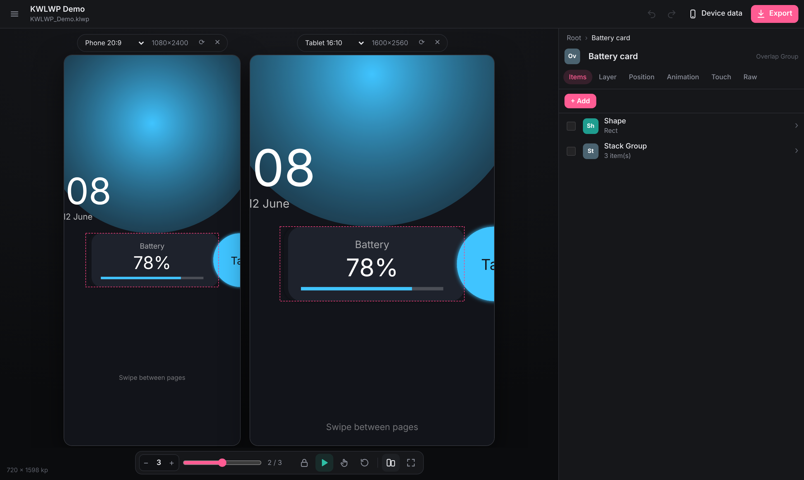
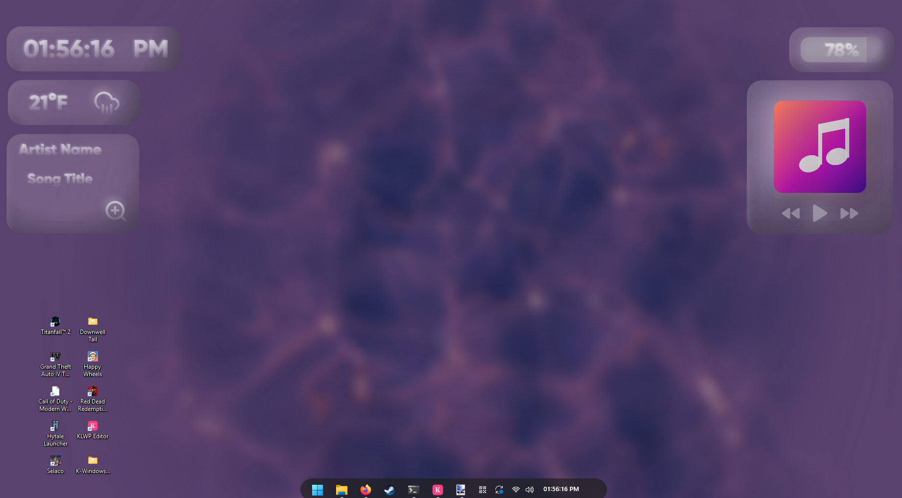

# KWLWP

A desktop editor for [KLWP](https://play.google.com/store/apps/details?id=org.kustom.wallpaper) presets with a live preview, and a Windows app that runs those presets as your live desktop wallpaper.



KWLWP is an independent project. It is not made by, affiliated with or endorsed by Kustom Industries, and it contains none of KLWP's code. You need KLWP itself to use the presets on Android.

## What's in here

**The editor** (`editor/`) is a single HTML file that runs in any modern browser, with no server and no install.

- Opens and saves `.klwp` and `.komp` files. Anything it does not understand is kept as it is, so a preset survives a round trip unchanged.
- Live preview at any resolution or aspect ratio, with several devices side by side.
- The same structure as KLWP's editor: items, tabs per item, globals, formulas, animations and touch actions.
- A simulated-device panel for battery, weather, music, notifications and the clock.
- Touch mode and a fullscreen preview: swipe between launcher pages and tap things like on a phone.

**The Windows app** (`windows/`) puts a preset behind your desktop icons, the way other live-wallpaper apps do.

- Swipe on the empty desktop (or scroll) to move between pages; click, double-click and hold run the preset's touch actions.
- Music actions press the PC's media keys, link actions open the browser, and the clock and battery are real.
- Rendering pauses while a maximised or fullscreen window covers the monitor.
- The editor is included as its own window and shares one **Kustom folder** with the wallpaper, laid out like the folder on your phone (`wallpapers`, `komponents`, `fonts`, `icons`, `bitmaps`).
- A per-user installer, with no administrator rights needed.

- **Random Personal KLWP Presets**

I threw in some random presets Ive been using for testing. Some of them are broken even on real KLWP so watch out.



## Getting started

### Just the editor

Build it (see below), then open `KLWP Desktop Editor.html` in a browser. Try it with `examples/KWLWP_Demo.klwp`.

To get a preset onto your phone, copy the exported file into `Kustom/wallpapers`. KLWP only notices files copied in from outside after it restarts, so force-stop KLWP (or reboot) before loading it; otherwise it reports "File not found".

### The Windows app

Requirements: Windows 10 or 11 (64-bit) with the Microsoft Edge WebView2 runtime, which Windows 11 includes and Windows 10 normally already has.

1. Double-click `build.bat`.
2. Run `dist\KLWP Wallpaper Setup.exe` and choose your Kustom folder (the default is `%APPDATA%\Kustom`).
3. Right-click the pink **K** icon near the clock to pick a wallpaper, set the number of pages, choose the layout and monitor, or open the editor.

To remove it, use Windows Settings > Apps. Your Kustom folder is left alone.

## Building

`build.bat` needs nothing installed. It uses the C# compiler and PowerShell that ship with Windows, and downloads Microsoft's WebView2 library from nuget.org the first time. Everything lands in `dist/`:

| File | What it is |
| --- | --- |
| `KLWP Wallpaper Setup.exe` | The installer, self-contained |
| `KLWPWallpaper.exe` (+ three DLLs) | The app, runnable in place |
| `KLWP Desktop Editor.html` | The editor on its own |

To build only the editor on any OS: `python3 editor/build.py` (output in `editor/dist/`).

The Windows code is deliberately limited to C# 5, because that is what the compiler built into Windows understands.

## Repository layout

```
editor/
  src/            the editor and renderer
    index.html      page shell
    style.css       styles
    app.js          editor UI, file handling, touch mode, wallpaper mode
    render.js       layout and canvas rendering of a preset
    formula.js      Kustom formula parser and evaluator, simulated device data
    schema.js       item types, their tabs and properties
    labels.js       display labels for option values
  vendor/         JSZip
  build.py        bundles src/ into one HTML file
  build.ps1       the same, for Windows without Python
windows/
  app/            the tray app (wallpaper window, editor window, uninstaller)
  installer/      the setup program
  assets/         icon and manifests
docs/             notes on the preset format, the renderer and the Windows app
examples/         a small demo preset
build.bat         builds everything into dist/
```

## How accurate is it?

The renderer was written by studying presets and comparing against screenshots and recordings from a real device, not from KLWP's source. Common things match closely; some do not yet. Known gaps:

- Layer effects, colour filters on groups and inner shadows are not drawn.
- Gyroscope-driven values are not simulated.
- "Morphing Text" and "Series" items render and are preserved, but cannot be added from the editor.
- Flows are edited as raw JSON.
- In the wallpaper, weather, music details and notifications still come from the simulated-data defaults.
- On the desktop, a drag also draws Windows' selection rectangle, and a click on an icon also counts as a tap on the wallpaper.

See [docs/rendering-notes.md](docs/rendering-notes.md) for the rules that were worked out, and [docs/preset-format.md](docs/preset-format.md) for the file format.

## License

[MIT](LICENSE). JSZip (`editor/vendor/`) is included under its own MIT license. "KLWP" and "Kustom" are names of Kustom Industries' products and are used here only to say what this project works with.
